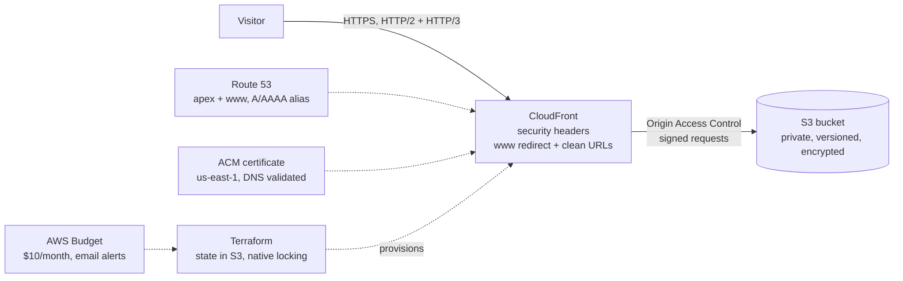

# personal-site

Source for [sudheerkancharla.dev](https://sudheerkancharla.dev): the personal portfolio
of Sudheer Kancharla, Senior Backend Engineer and Tech Lead.

It is also a hands-on infrastructure project: the site is deliberately simple so the
interesting work happens in infrastructure as code, CI/CD and documentation. It is live,
served from a private S3 bucket through CloudFront, with everything provisioned by Terraform.



## Repository layout

| Path                  | What                                                     |
| --------------------- | -------------------------------------------------------- |
| `site/`               | Astro static site (TypeScript strict, plain CSS)         |
| `infra/`              | Terraform for the AWS hosting ([details](infra/README.md)) |
| `docs/adr/`           | Architecture Decision Records                            |
| `docs/architecture/`  | Architecture notes                                       |
| `docs/case-study-template.md` | Template for new case studies                    |
| `.github/workflows/`  | CI/CD pipelines (Phase 4, next)                          |

## Running locally

Requirements: Node.js 24 (see `.nvmrc`) and npm.

```sh
nvm use            # picks up .nvmrc
cd site
npm install
npm run dev        # http://localhost:4321, draft content is visible
npm run build      # static output in site/dist/, drafts excluded
npm run preview    # serve site/dist/ locally
```

`site/dist/` is plain static files (HTML, CSS, images) and can be uploaded to any static
host, such as S3.

## Content

- Experience entries: `site/src/content/experience/*.md`
- Projects: `site/src/content/projects/*.md`
- Case studies: `site/src/content/case-studies/*.md`. Copy `docs/case-study-template.md`.
  Set `draft: true` to keep a case study out of production builds.
- Name, URLs, social links, SEO defaults: `site/src/site.config.ts`
- Skills: `site/src/data/skills.ts`

## Roadmap

1. ✅ **Phase 1: local build.** Astro site, content collections, SEO, ADRs.
2. 🟡 **Phase 2: content.** Real copy, CV and OG image done; case studies in progress.
3. ✅ **Phase 3: AWS hosting with Terraform.** S3 + CloudFront (OAC) + ACM + Route 53,
   remote state with native locking, CloudFront Function for index rewrites, security
   headers, cost budget with alerts.
4. ⏭️ **Phase 4: CI/CD.** GitHub Actions with OIDC to AWS, build + deploy + cache
   invalidation, Terraform plan on PRs.
5. **Phase 5: observability.** CloudFront logs/metrics, alarms, uptime checks.
